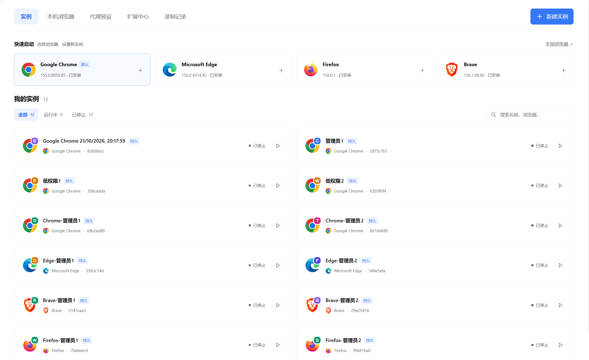
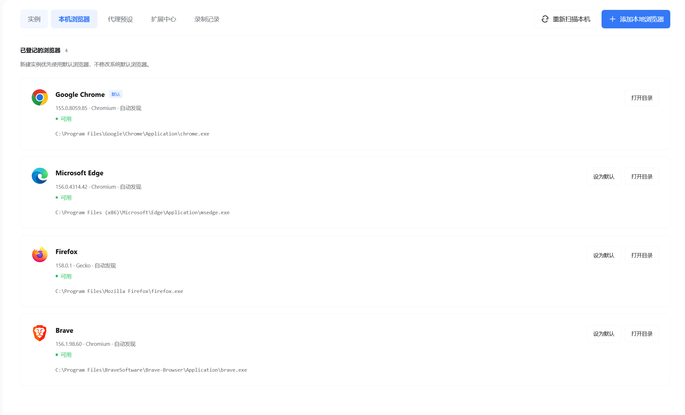
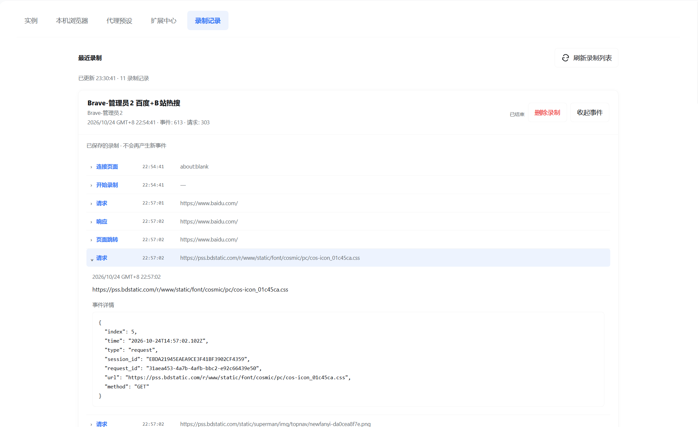

# Browser Flock

**Manage multiple isolated local browser instances with DeepSeek Harness.**

[中文](README.md) | English

Create separate browser profiles for different accounts. Ask AI to launch multiple instances, assign proxies, load the same extensions, and record browser interactions and HTTP traffic. Persistent instances retain their own sign-in state; temporary profiles are removed after confirmed browser exit.

> Windows · `0.1.2` · DeepSeek Harness `0.2.1-rc.5` · MIT
>
> **Windows + Chrome** is the primary development environment. Edge, Brave and Firefox have limited real-browser coverage and known limitations. macOS and Linux are not currently supported.

## Why Browser Flock?

Managing several accounts in one browser profile can mix up sign-in state. Browser Flock gives each instance a separate profile and exposes tools that let DeepSeek Harness create, manage and connect to those instances.

Cookies, site data, sign-ins and extension storage stay separate. Instances can use different proxies while sharing the same extension code. **This is browser-profile isolation, not a virtual machine, an OS security boundary or browser-fingerprint spoofing.**

## Features

| Feature | What it does |
| --- | --- |
| Local browser discovery | Finds Chrome, Edge, Brave and Firefox, verifies executable identity and supports manual registration |
| AI-driven batch management | AI coordinates repeated tool calls to create, reopen, close, rename or delete instances |
| Independent account environments | Persistent and temporary profiles without taking over your everyday browser profile |
| Per-instance proxies | System, direct, HTTP and SOCKS5 settings applied when creating instances |
| Extension library | Captures extension code from managed browsers and loads it into multiple Chromium instances with separate storage |
| CDP connections | Returns verified local endpoints for AI-written scripts or clients such as Playwright |
| Interaction recording | Captures clicks, input, navigation and HTTP requests/responses; other sessions in the same Harness profile can read saved recordings |
| Bilingual management page | Manages instances, browsers, proxies, extensions and recordings |

Batch operations are AI orchestration of multiple calls, not a dedicated one-click batch tool. Proxy settings are copied into each instance when it is created. Editing a preset does not change existing instances, and live proxy switching is not supported.

## Compatibility

| Environment | Status |
| --- | --- |
| Windows + Chrome | Primary development and testing environment |
| Windows + Edge / Brave | Limited live tests cover CDP, recording, extension storage isolation and reopening; Brave normal close can time out |
| Windows + Firefox | Discovery, persistent lifecycle and HTTP proxy tested; no plugin CDP, recording or extension-library support |
| macOS / Linux | The current Host rejects these platforms; contributions welcome |

Version 0.1.2 passed its build, syntax checks and **141/141 automated tests** with Harness `0.2.1-rc.5` dependencies and restores embedded browser brand icons. Live checks during the rc.5 compatibility update covered installation, AI query tools, Client slot registration and existing-data reads. Visual display after the icon fix has not been independently rechecked. Earlier Windows integration tests on rc.3 passed HTTP proxy checks for all four browsers and recording/extension assertions for the three Chromium browsers. See [testing notes](docs/TESTING.md) for coverage and failures. Results do not guarantee compatibility with every browser version, extension or website.

## Installation

1. Install **DeepSeek Harness `0.2.1-rc.5`** and a supported browser yourself. Development and standalone scripts require Node.js 22+. Plugin v0.1.0 targets Harness rc.3.
2. Download `local-dsh-browser-flock-0.1.2.tgz` from [GitHub Releases v0.1.2](https://github.com/Lmg66/dsh-browser-flock/releases/tag/v0.1.2). Verify it against the accompanying SHA-256 checksums. To build from source, run `pnpm install --frozen-lockfile --ignore-scripts`, then `pnpm pack --pack-destination releases`.
3. Ask Harness to install it, using the actual local path:

```text
Use plugin_manager install_bundle to install this Browser Flock plugin:
C:\Downloads\local-dsh-browser-flock-0.1.2.tgz
Check application, warnings and nextStep in the installation result.
If it returns already-installed, remove the @local/dsh-browser-flock installation entry
with remove_bundle before installing the new package. Preserve existing browser data.
```

After successful application, refresh Harness and look for **Browser Flock** in the sidebar.

The repository retains the `@local/dsh-browser-flock` identity and `private: true`. It is distributed through GitHub and local tarballs; npm publication is not required. Installation still needs to resolve its declared DSH dependencies. Stop active recordings before upgrading. Do not delete browser data just to upgrade the plugin.

## Usage

### 1. Separate account environments

Open Instances, choose a browser, create a persistent instance and sign in manually in its window. Reopening the same instance preserves its saved sign-in state.

Or ask AI:

```text
List my local browsers, then create three persistent Chrome instances
named Work A, Work B and Testing. Return their instance IDs.
```

### 2. Configure proxies for multiple instances

Save a host and port under Proxy presets, then select that preset when creating instances. AI can also reuse one preset across multiple creation calls:

```text
Save an HTTP proxy preset named Local proxy at 127.0.0.1:7890.
Create three persistent Chrome instances using that preset.
```

The example port must match an actual running proxy. HTTP and SOCKS5 are supported; proxy credentials and PAC are not. The plugin does not change the Windows system proxy or install root certificates. Loopback targets may bypass proxies under browser defaults.

### 3. Load the same extension into multiple instances

Install the extension in a managed Chromium instance, then scan and capture its code in the extension library and install it into target instances. AI can list library IDs and supply the same `extension_library_ids` when creating each instance.

Only code is copied, not accounts, cookies or extension storage. Each instance keeps its own code copy: deleting the shared library entry does not affect installed instances, queued loads or reopening. Captured versions do not automatically follow store updates. Extensions depending on fixed IDs, native messaging or store identity may be incompatible.

### 4. Control pages and record interactions

AI can call `get_browser_instance_cdp` to retrieve a Chromium instance's current endpoint, then control pages with a compatible CDP client. Endpoints listen on loopback only and may change after reopening; do not cache them.

Start recording in instance details, interact with the browser and stop recording. Inspect events and HTTP details on the Recordings page. Another AI conversation in the same Harness profile can list and read saved recordings.

**Recordings preserve raw input, including passwords, cookies, Authorization headers and request/response bodies.** They are stored locally and can be read through tools by other AI sessions in the same profile. Review sensitive content before sharing recordings, and keep them out of public repositories.

Recording is not complete packet capture or automated replay. Body/event limits apply and missing or truncated content is marked. WebSocket frames and console logs are not captured; some Worker traffic and activity before target attachment may be missed.

### Storage and deletion

Data lives under `data/browser-flock` in the current Harness profile and persists across conversations. Uninstalling the plugin does not close instances or delete their data. Persistent instances require explicit deletion; temporary data is removed after confirmed exit. Recordings are independent, so deleting a browser instance does not delete its recordings.

## Project structure

```text
.
├── src/
│   ├── host/            # Lifecycle, proxies, extensions, recording, services and AI tools
│   │   └── platform/    # Windows process verification and window identity
│   ├── client/          # Management UI and original browser letter icons
│   └── shared/          # Validation, RPC and errors
├── locale/              # English/Chinese plugin metadata
├── test/                # Regression tests; both test directories are used
├── tests/
├── scripts/             # Build, checks and live verification
├── docs/                # Testing notes, screenshots and release copy
├── client.js            # Generated client artifact
├── cordis.patch.yml     # DSH bundle registration
├── package.json
└── LICENSE
```

## Development and contributions

```powershell
pnpm install --frozen-lockfile --ignore-scripts
pnpm run build
pnpm run check
pnpm test
pnpm pack --pack-destination releases
```

Packing automatically builds the client, checks syntax and runs all tests. Edit `src/client/` and rebuild rather than maintaining generated `client.js` manually. `node --test` discovers both test directories. Live verification scripts launch dedicated browser instances and require Windows; see [testing notes](docs/TESTING.md).

AI-assisted contributions are welcome, especially platform/browser adaptations, close behavior and UI improvements. Include your DSH/browser versions, reproduction steps and test results. See the [release guide](RELEASING.md).

## Screenshots

These real screenshots supplied by the user show instance management, local browser discovery and recording details. Version 0.1.2 restores browser brand icons and embeds them in the distribution for offline display.

### Instances



### Local browsers



### Recordings



See [screenshot notes](docs/screenshots/README.md) for provenance and additional CDP evidence.

## Known issues

- Normal close can time out for some persistent Brave instances. The plugin does not automatically force termination. Explicit force close may lose unsaved work.
- SOCKS5, external HTTPS CONNECT, long recordings, multiple monitors and taskbar appearance have not received complete live verification.
- Data is retained when process ownership or exit cannot be verified, avoiding deletion of a profile still in use.
- CDP can access instance pages and sign-in state; other local processes may also connect. It is not a security boundary.

## License

[MIT License](LICENSE) permits use, copying, modification, distribution, derivative work and commercial use, provided the copyright and permission notice are retained. The software is supplied as-is without warranty.

This release uses original letter icons. Browser names and third-party dependencies remain subject to their respective rights and licenses; see [third-party notices](THIRD_PARTY_NOTICES.md). This is an independent community project.
